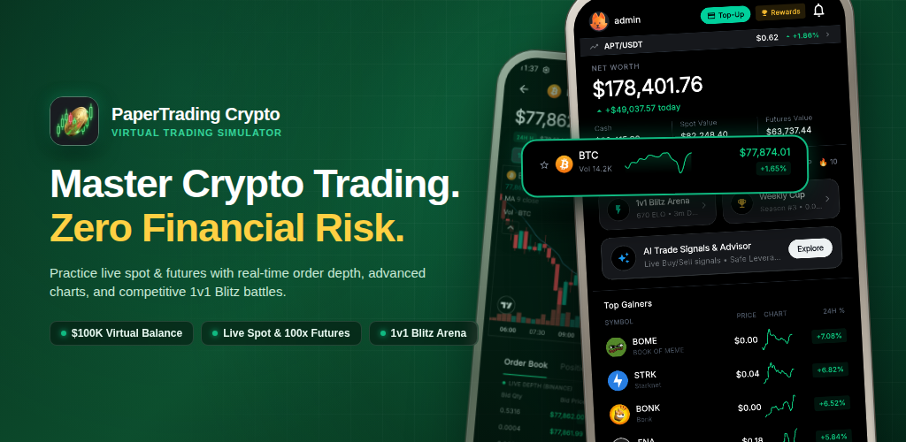
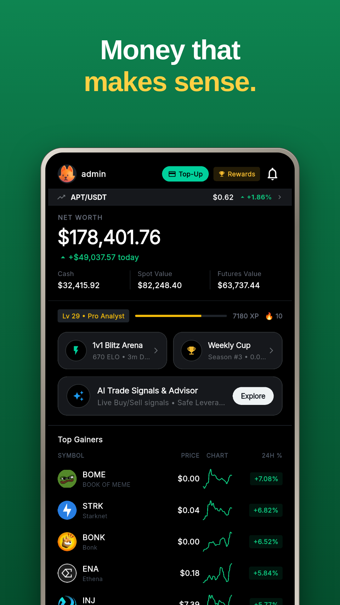
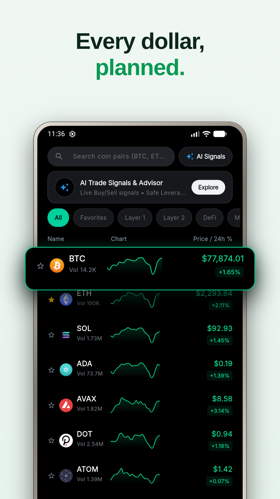
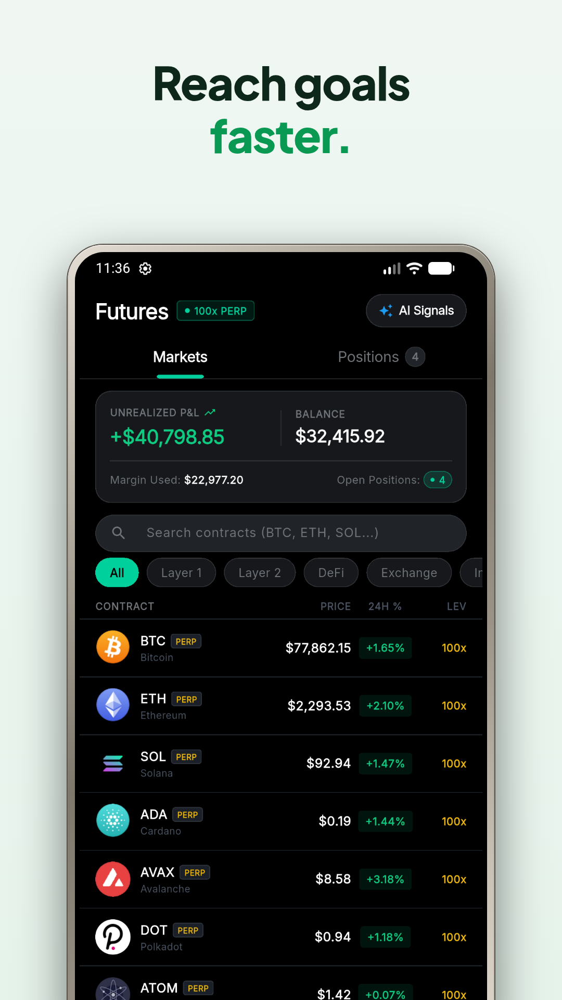
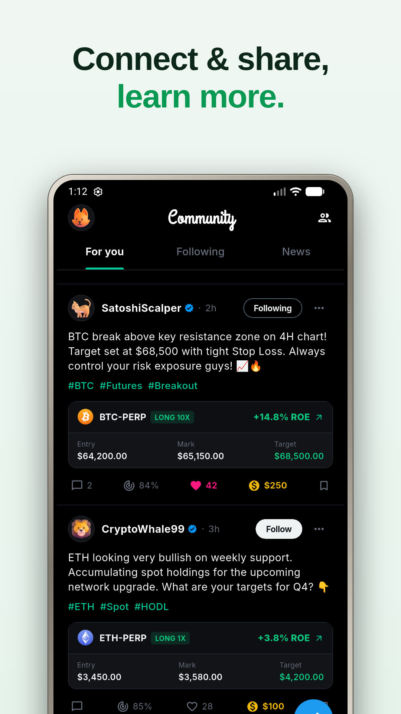
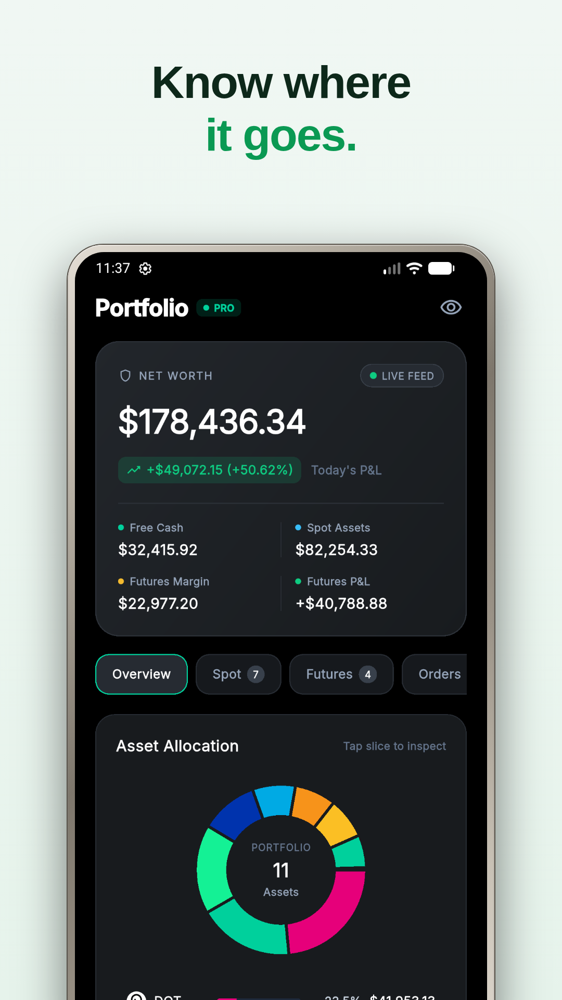
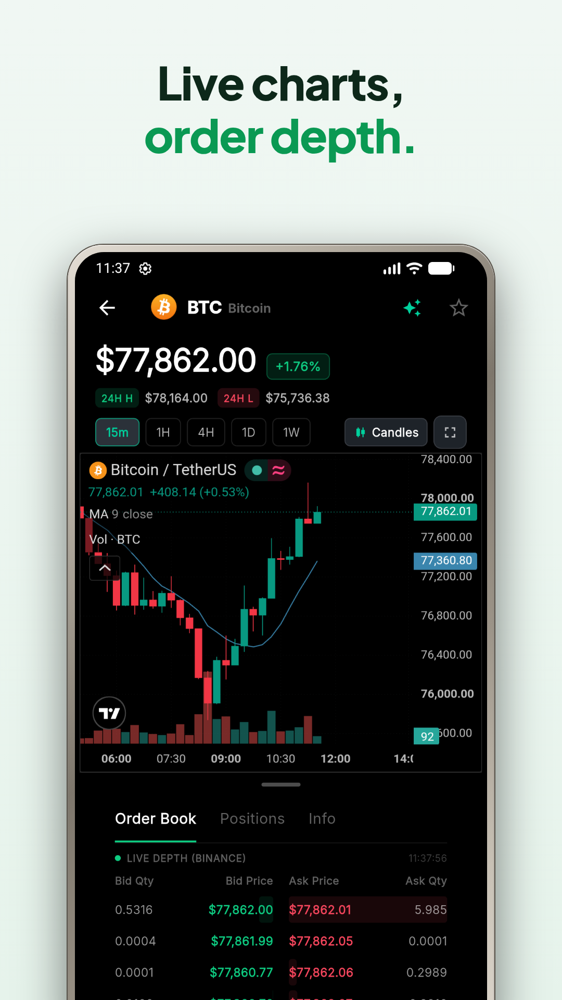
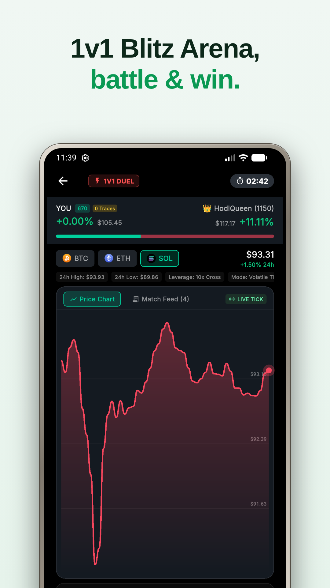
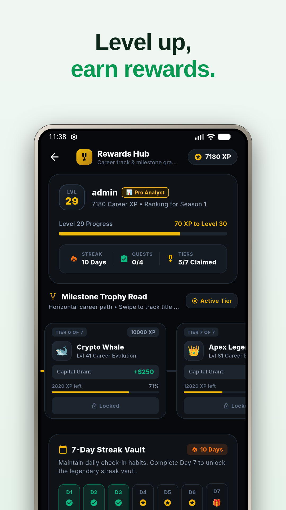
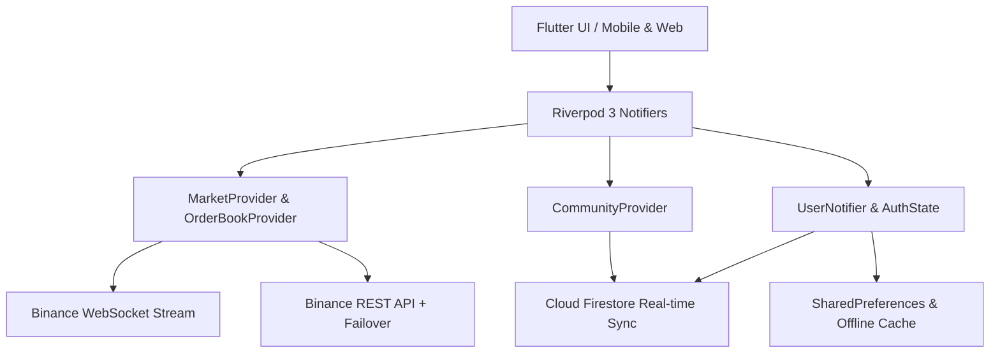

<div align="center">
  
  
  
  
  
  
</div>

<h1 align="center">AcadrioTrade (Stock Arena) 📈</h1>

<p align="center">
  <b>A comprehensive, real-time crypto & paper-trading simulation platform with futures leverage, 1v1 blitz duels, social feeds, and live Binance streaming.</b><br>
  Built with Flutter, Riverpod, and Firebase for high-performance mobile and web deployment.
</p>

---

## 📱 App Preview

<p align="center">
  
</p>

| Dashboard | Markets | Futures Pro | Community |
|:---:|:---:|:---:|:---:|
|  |  |  |  |

| Portfolio | Interactive Charts | 1v1 Blitz Duel | Rewards & Quests |
|:---:|:---:|:---:|:---:|
|  |  |  |  |

---

## 🚀 Key Highlights & Capabilities

### ⚡ Live Market & Advanced Trading Engine
- **Sub-Second Live Streaming**: Real-time ticker feeds, 24h stats, and live order books via resilient Binance WebSocket and REST fallbacks.
- **Interactive Pro Charts**: Candlestick and line charts (1D, 1W, 1M, 1Y, 5Y) with volume indicators, pinch-to-zoom, and crosshair inspections.
- **Futures Pro & Leverage**: Practice futures trading with up to 20x leverage, liquidation estimation, stop-loss / take-profit calculations, and isolated margin models.
- **Spot Trading & Order Book**: Deep order book visualization with bid/ask depth spread and instant order execution simulation.

### ⚔️ Gamification & Social Community
- **1v1 Blitz Duels**: Challenge other traders in rapid real-time paper trading battles to climb seasonal ranks.
- **Global Tournaments**: Compete in timed championships with dynamic prize pools and transparent rules.
- **Trader Community Feed**: Share market insights, create posts, tip traders in virtual currency, and vote on community analysis.
- **Leaderboards & User Profiles**: Global rankings with an interactive podium, XP progression, and badge achievements.
- **Algorithmic Signal Engine**: Actionable momentum, breakout, and RSI signals to help traders learn entry/exit timing.

### 🌐 Cross-Platform & Resilience
- **Responsive Web Terminal**: Professional multi-pane desktop trading station (`/web`) with synchronized chart, order book, and portfolio panels.
- **Offline & Network Resilience**: Automatic host fallbacks, non-blocking startup initialization, local data caching, and synthetic candle generation for seamless operation under unstable network conditions.
- **Multi-Currency System**: Instant real-time toggle between USD and INR base currency reporting.

---

## 🏗 Architecture & Tech Stack



- **Frontend / Framework**: Flutter (Material 3 Dark Theme with OLED optimization)
- **State Architecture**: Flutter Riverpod 3 (immutable state models, synchronous initializers, auto-dispose guards)
- **Backend & Cloud**: Firebase Authentication, Cloud Firestore, Firebase Storage
- **Market Feed**: Binance Public WebSocket (`wss://stream.binance.com`) with HTTP polling backup
- **Charts**: Syncfusion Flutter Charts, FL Chart, and TradingView WebView integration
- **Packaging**: Android App Bundle (AAB), APK, macOS, and responsive Progressive Web App (PWA)

---

## 📂 Project Directory Structure

```text
lib/
├── core/                        # Core configuration, themes, & utility engines
│   ├── app_theme.dart           # OLED black design system & typography
│   ├── currency_formatters.dart # Dynamic multi-currency formatting (USD/INR)
│   ├── signal_engine.dart       # Technical analysis & trading signal detection
│   ├── topup_offer_manager.dart # Native promotional capital sheet
│   └── update_manager.dart      # Version verification & in-app update prompts
├── data/                        # State layer & domain models
│   ├── models.dart              # UserState, Position, Holding, & Stock models
│   ├── market_provider.dart     # Resilient Binance price & candle stream
│   ├── user_provider.dart       # Portfolio balance, positions, & Firestore sync
│   └── order_book_provider.dart # Live bid/ask order book state
└── features/                    # Modular feature screens & widgets
    ├── blitz/                   # Real-time 1v1 trading duels
    ├── community/               # Social posts, tipping, comments, & trader profiles
    ├── dashboard/               # Main portfolio overview & quick stats
    ├── futures/                 # Pro futures leverage terminal & position cards
    ├── leaderboard/             # Global rankings & 3-podium showcase
    ├── market/                  # Market watchlists & spot trading sheet
    ├── signals/                 # Algorithmic market signals dashboard
    ├── stock_detail/            # Detailed candlestick chart & asset statistics
    ├── tournaments/             # Trading championship events
    └── web/                     # Desktop / Web multi-panel terminal
```

---

## 🛠 Getting Started

### Prerequisites
- **Flutter SDK**: `>= 3.4.0 < 4.0.0`
- **Dart SDK**: Compatible with Flutter version
- **Java**: OpenJDK 17 (for Android builds)
- **Firebase Project**: Configured with Firestore & Firebase Authentication

### Setup Instructions

1. **Clone the repository**:
   ```bash
   git clone https://github.com/clawalone/Paper-Trading---Crypto.git
   cd Paper-Trading---Crypto
   ```

2. **Install project dependencies**:
   ```bash
   flutter pub get
   ```

3. **Configure Firebase**:
   - Place your `google-services.json` inside `android/app/`.
   - Place `GoogleService-Info.plist` inside `ios/Runner/` (if targeting iOS).
   - Alternatively, configure via FlutterFire CLI:
     ```bash
     flutterfire configure
     ```

4. **Run the application**:
   ```bash
   # Run on connected mobile device or emulator
   flutter run

   # Run responsive web terminal
   flutter run -d chrome
   ```

5. **Execute Unit & Resilience Tests**:
   ```bash
   flutter test
   ```

---

## 📦 Building for Production

### Android Release Bundle (`.aab`):
```bash
flutter build appbundle --release
```
*The output bundle will be located at `build/app/outputs/bundle/release/app-release.aab`.*

### Web Production Build:
```bash
flutter build web --release
```

---

## 🤝 Contributing
Contributions, feedback, and feature suggestions are welcome!
1. Fork the Project
2. Create your Feature Branch (`git checkout -b feature/AmazingFeature`)
3. Commit your Changes (`git commit -m 'Add some AmazingFeature'`)
4. Push to the Branch (`git push origin feature/AmazingFeature`)
5. Open a Pull Request

---

## 📄 License
Distributed under the MIT License. See [LICENSE](LICENSE) for more information.

<div align="center">
  <sub>Built with ❤️ for crypto traders and financial market enthusiasts.</sub>
</div>
